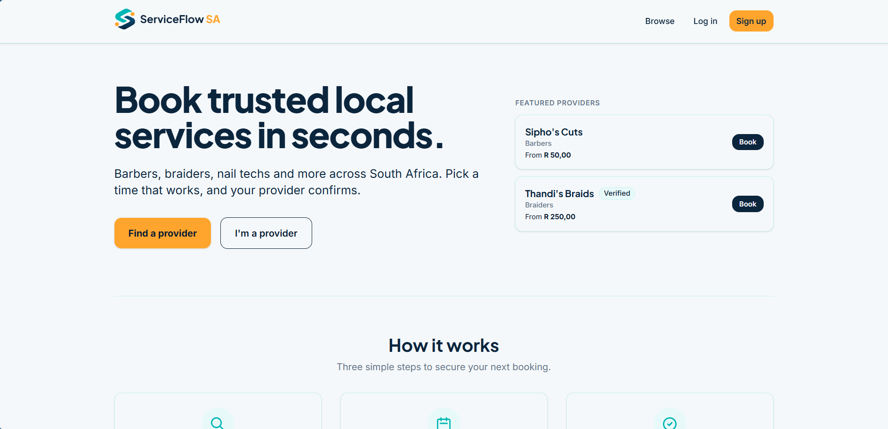
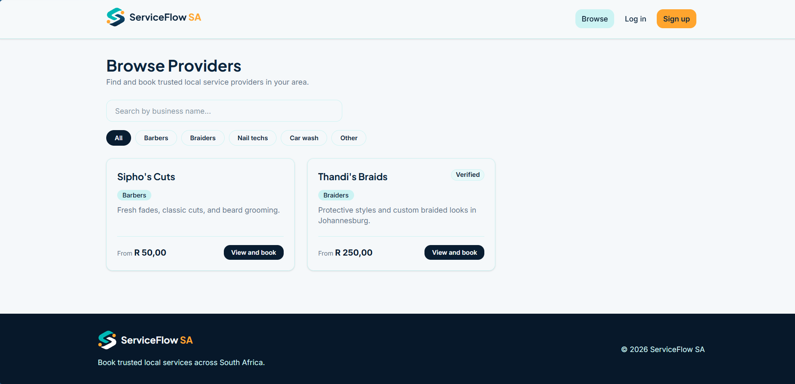
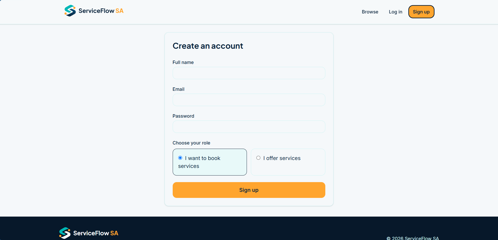
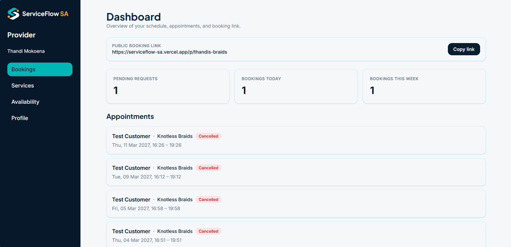
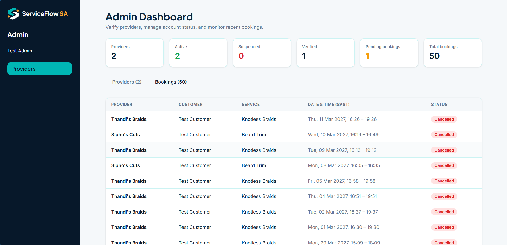

# ServiceFlow SA

> ServiceFlow SA gives independent barbers, braiders and nail techs a simple booking
> link, so clients book a time slot instead of waiting in a queue, and providers stop
> losing money to walk-aways, double-bookings and buried WhatsApp messages.

| | |
|---|---|
| **Live app** | https://serviceflow-sa.vercel.app/ |
| **Stitch designs** | [Stitch project](https://stitch.google.com/projects/15248736337446016447) (also exported in [`docs/designs/`](./docs/designs/)) |
| **Business case** | [BUSINESS.md](./BUSINESS.md) |
| **PRD** | [docs/PRD.md](./docs/PRD.md) |
| **Implementation plan** | [IMPLEMENTATION_PLAN.md](./IMPLEMENTATION_PLAN.md) |
| **Project board** | [ServiceFlow SA Roadmap](https://github.com/users/analystmodikwe/projects/13) |
| **Demo video** | Loom: [Watch the Loom pitch and demo](https://www.loom.com/share/28c88eeb852447c88e613c6d844a80b7) |

## Test logins
Demo accounts with sample data. All use the password `ServiceFlow!2026`.

| Role | Email | Lands on |
|---|---|---|
| Customer | customer@example.com | `/my-bookings` |
| Provider (Thandi's Braids) | provider@example.com | `/provider` |
| Provider (Sipho's Cuts) | provider2@example.com | `/provider` |
| Admin | admin@example.com | `/admin` |

## Screenshots
| | |
|---|---|
|  |  |
|  |  |
|  | |

## What it does
- **Customers** browse providers, pick a service, choose an open time slot and book.
  They track and cancel their own bookings.
- **Providers** create a profile, list services (price and duration), set weekly
  availability, share one booking link, and confirm or decline requests.
- **Admins** verify or suspend providers and see recent bookings.
- **No double-booking:** overlapping bookings for the same provider are rejected by a
  database constraint, not just by the interface.

### Roles and permissions
| Role | Can do |
|---|---|
| Customer | Browse providers, book, view and cancel own bookings |
| Provider | Manage own profile, services and availability; confirm or decline bookings for own business |
| Admin | View all providers and bookings; verify or suspend providers |

Permissions are enforced in the database with Supabase Row Level Security and
triggers, not in the frontend. Admin cannot be chosen at signup; it is assigned in
the database.

## Tech stack
| Area | Technology |
|---|---|
| Frontend | React, TypeScript, Vite, React Router |
| Styling | Tailwind CSS |
| Backend and database | Supabase (Postgres, Auth, Row Level Security) |
| Testing | Vitest, React Testing Library, RLS integration tests |
| CI | GitHub Actions (lint, typecheck, test, build) |
| Hosting | Vercel |
| Design | Stitch |

## Architecture
```text
 Browser (React + TypeScript SPA)
        |
        |  Supabase JS client (anon key + user session)
        v
 Supabase
   |- Auth       signup / login, JWT session
   |- Postgres   profiles, providers, services, availability, bookings
   |- RLS        role and ownership rules on every table
   |- Triggers   profile on signup, booking end time, allowed status changes
   '- Constraint no overlapping bookings per provider
```
```text
src/auth        auth context, role guards
src/components  layouts, logo, shared UI
src/lib         Supabase client, API functions, slot generation, date helpers
src/pages       public, customer, provider and admin pages
supabase/migrations   schema and RLS (SQL)
scripts/seed.mjs      demo data and test logins
tests/rls             permission tests against the hosted database
```

## Run it locally
**Requirements:** Node.js 22 or newer, npm, and a Supabase project.
```bash
git clone https://github.com/analystmodikwe/serviceflow-sa.git
cd serviceflow-sa
npm install
cp .env.example .env.local     # then fill in the values below
npm run dev
```
`.env.local`:
```text
VITE_SUPABASE_URL=<your project url>
VITE_SUPABASE_ANON_KEY=<your anon / publishable key>
SUPABASE_SERVICE_ROLE_KEY=<service role key: used only by the seed script, never in the frontend>
```
Set up the database by running the two files in `supabase/migrations/` in order in
the Supabase SQL editor, then load the demo data:
```bash
npm run seed
```

## Run the tests
```bash
npm test            # unit and component tests (Vitest), also run in CI
npm run test:rls    # permission tests against the hosted database (needs .env.local)
npm run lint
npm run typecheck
npm run build
```
The RLS tests sign in as real users (customer, two providers, admin) and check what
each one can read and change. They are not part of CI because they need the live
database.

## How the project is built
Solo project, built the way the course teaches: PRD, Stitch designs, implementation
plan, then a phase-by-phase build with tests, then deploy.
- Work is tracked as GitHub Issues grouped into milestones, with a project board.
- Every change goes Issue, branch, pull request, merge, with small commits.
- `main` is protected: no direct pushes, and a pull request needs a passing `ci`
  check to merge.

## Known issues and limitations
- No online payments, reminders or notifications yet (out of scope for this release).
- Walk-in queue management is not built; it is the planned next feature for shops.
- Email confirmation is switched off on the demo project so test logins work.
- Demo data is fictional. The RLS tests create and cancel bookings in the live
  database, so cancelled test bookings can appear until they are cleaned up.

## Author
Built by **Lesedi Modikwe**, AI Full Stack Software Developer.

- [GitHub](https://github.com/analystmodikwe)
- [LinkedIn](https://www.linkedin.com/in/lesedi-modikwe/)
- Email: [lmodikwe10@gmail.com](mailto:lmodikwe10@gmail.com)
- Email: [analystmodikwe11@gmail.com](mailto:analystmodikwe11@gmail.com)
